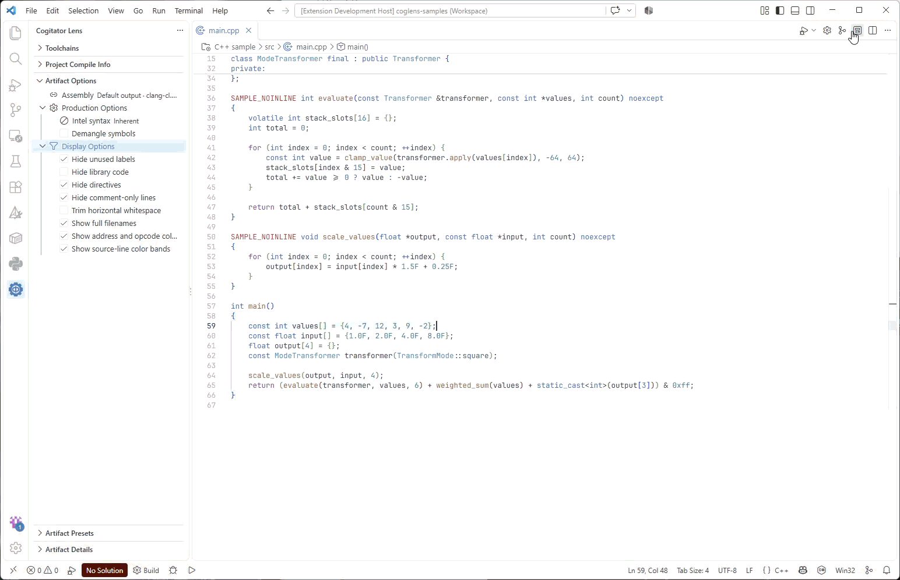

# Cogitator Lens

Cogitator Lens is a VS Code extension for inspecting compiler and interpreter artifacts.



## Usage

Open a source file and run `Cogitator Lens: Open Artifact`. Without any configuration, Cogitator
Lens uses the compilers and interpreters it finds on `PATH`: `gcc`, `clang`, `rustc`, `python3` (or
`python`), `go`, `zig`, `dotnet`, `javac`, and `nvcc`. It also finds versioned compilers, such as `gcc-14`
and `clang-18`, and the same compiler in other `PATH` folders. It finds each rustup toolchain that
differs from the `rustc` on `PATH`. On Windows, it finds `cl` and `clang-cl` on `PATH`. It also finds
each MSVC toolset and the clang-cl of each Visual Studio install, without a developer prompt. Run
`Cogitator Lens: Detect Toolchains` after you install a new one. Set `coglens.detectToolchainsOnPath`
to `false` to turn detection off. When several toolchains compile a file, run `Cogitator Lens: Select
Compilation Variant` to switch between them.

Cogitator Lens also discovers C and C++ compile settings from `compile_commands.json` and
`build/compile_commands.json` in each workspace folder. Set `coglens.compilationDatabases` to use
other paths, or to `[]` to disable compilation-database discovery.

It also reads the configurations of the C/C++ extension in `.vscode/c_cpp_properties.json` and the
`C_Cpp.default` settings. A configuration with a `compilerPath` gives a variant to each source in
its folder that has no other variant. The variant uses the include paths, defines, forced includes,
language standard, and `compilerArgs` of the configuration. The compiler must exist on this
computer, so a "Mac" configuration gives no variant on Windows. The configuration for the platform,
such as "Win32", comes first, and `coglens.defaultInvocation` comes before all of them. On Windows,
a bare `cl.exe` or `clang-cl.exe` that is not on `PATH` comes from the first Visual Studio install.
In a C header, the variant uses the C arguments when the language of the editor is C. A recursive
include path, such as `${workspaceFolder}/**`, adds only its base folder, because compilers do not
search below an include folder. The `compileCommands` database of a configuration gives the
variants of its sources. Set `coglens.cppToolsConfiguration` to `false` to turn this off.

When [CMake Tools](https://marketplace.visualstudio.com/items?itemName=ms-vscode.cmake-tools) is
installed, its configured projects are also available. If both sources describe a file, select the
required variant in the picker.

It also reads each Cargo workspace with `cargo metadata`. Each Rust source of a package gets a
variant that runs `cargo rustc` for the target that compiles the source. The target is the library,
a binary, an example, a test, or a benchmark. A module file compiles with its crate. With "Show
library code" off, the listing keeps the code of the module only. The variant uses the `release`
profile. Set `coglens.cargoProfile` to use another profile, such as `dev`. A target with
`required-features` gets these features. The compiles use the folder `coglens` of the target
directory. So they do not wait for rust-analyzer, and they do not change the files of your builds.
The first compile also builds the dependencies of the package, and it can need more time than
`coglens.processTimeout`. An edit in a crate of the workspace that the package uses also refreshes
the artifact. Set `coglens.cargoWorkspaces` to `false` to turn this off.

Use the sidebar to browse variants and toolchains. Run `Cogitator Lens: Open Artifact` to generate
an artifact for the active variant. Run `Cogitator Lens: Compare Artifacts` to compare a supported
text artifact from two variants or presets. Control-flow graphs open in their own view. The
**Cogitator Lens** submenu of the editor context menu has these commands, and the explorer context
menu has **Open Artifact** for a source file. The **Get Started with Cogitator Lens** walkthrough
shows the first steps.

Saving the source regenerates its open artifacts. A slow first compile opens the artifact at once
with a "Compiling…" line, and the output replaces it when the compile ends. When a compile fails,
the editor keeps the last successful output and marks it on the first line; hover there for the
compiler output. Diagnostics appear in the Problems view, for text artifacts and control-flow graphs.
Open artifacts follow edits to their variant and toolchain. An empty listing names the likely
causes, such as an unused `static` function or a template without an instantiation.

Artifacts that need the same compiler output share one compile, such as the assembly and its
control-flow graph. The same compile also lists the headers that the source reads, and an edit to a
header then refreshes the artifact. The number of compiles at the same time is half the processor
cores, and at least two. The other compiles wait. **Cancel Artifact Generation** stops a compile only
when no other open artifact needs it.

By default, the compiler reads the saved file. While a source has unsaved changes, the status bar
shows "Unsaved source", and the artifact says so on its first line. The highlights between the
source and the artifact move with your edits.

Set `coglens.compileOnType` to compile the unsaved text. When typing pauses for half a second, the
open artifacts of the source compile the text of the editor, and they update without a save. Until
the compile ends, the highlights move with your edits. A compile of unsaved text adds nothing to the
Problems view, because its errors come and go while you type. A failure keeps the last listing and
says so on its first line. A save compiles the saved file once, and its diagnostics go to the
Problems view.

Each output still names the source, also in the diagnostics and the file links. GCC, cl.exe, nvcc,
and Roslyn read a copy of the text that starts with a `#line` directive, and the folder of the
source is the first include folder. For cl.exe and nvcc, that folder also applies to
`#include <...>`. For GCC and nvcc, it also applies to `#include "..."` in a header in a different
folder. Then a header there can hide a header with the same name in a later include folder. A
compile of the saved file does not have this limit.
Clang and clang-cl read the text through a virtual file system. rustc reads a copy and gets
`--remap-path-prefix`. Go uses `go build -overlay`, and the Python helpers compile the text with
the name of the source. javac reads a copy with the name of the source, in another folder. Some
sources still compile the saved file: each Zig source, each source of a Cargo variant, a Rust crate
with module files, `#[path]`, or `include!`, and a saved file that is not UTF-8 text. The first line
of the artifact then gives the reason.

The status bar shows the state of the focused artifact. When the focus is in a source, it shows a
visible artifact of that source. Click it for the artifact actions: refresh, cancel, reveal the
source, and raise a limit that cut the output. **Refresh Artifact** and **Cancel Artifact
Generation** use the same artifact.

### Experiments

The status menu also changes and compares the artifact:

- **Edit Compiler Arguments** adds arguments to one artifact. They follow the arguments of the
  variant and the preset, and the tab stays open. **Set Optimization Level** selects a level, such
  as `-O2`, `/O2`, or `-C opt-level=2`. **Save as Preset** keeps the edited arguments as a preset.
  An MSVC level of `/O1`, `/O2`, or `/Ox` also removes the `/RTC` checks of the variant, because
  cl.exe does not accept them together.
- Toggles turn the options of the artifact kind on and off, such as Intel syntax and demangling.
- **Compare With Previous Result** compares the listing with the listing before the last change.
- **Snapshot Artifact** keeps the listing until VS Code closes. **Compare With Snapshot** compares an
  artifact with a snapshot.
- **Filter Optimization Remarks** selects the remark categories that the editors show.

`Cogitator Lens: Compare Artifacts` also offers each other toolchain that compiles the language. A
toolchain that reads the same arguments, such as Clang for a GCC variant, keeps the arguments of the
selected variant. Otherwise, the comparison uses no variant arguments and shows a warning. For
assembly, binary disassembly, LLVM IR, and Rust MIR, the comparison can show one function. When the
other compiler names the function in another way, you also select the function of the right listing.
The comparison can also renumber local labels and hide addresses, so the diff shows only changed
instructions. Compare Artifacts does not offer the optimization pipeline, because it shows one
function. To compare two pipeline results, use **Compare With Previous Result** or a snapshot.

### Optimization remarks

The **Optimization remarks** artifact shows the source with the remarks of the compiler above each
line. A remark is passed, missed, or analysis.

- GCC uses `-fopt-info-all`. Clang and clang-cl use `-fsave-optimization-record`.
- rustc uses `-C remark=all`. The size-info remarks, which give the instruction count after each
  pass, are left out.
- Go uses `-gcflags=-m=2`. An inlined call and a value that does not escape are passed. A function
  that cannot be inlined and a value that escapes to the heap are missed. The explanation of each
  escape is left out.
- cl.exe uses `/Qvec-report:2` and `/Qpar-report:2`. Each loop shows if it was vectorized. A reason
  code also shows its description from the Microsoft documentation. Add `/Qpar` to also see the
  parallelizer.

A compile without optimization gives few remarks or none. cl.exe reports only on loops. A remark on
code that came from a library, such as the loop of a Rust slice iterator, has the location of the
library line, so the artifact does not show it. Artifact Details counts these remarks as omitted.

### Optimization pipeline

The **Optimization pipeline** artifact shows the compiler passes that ran on one function. Clang,
clang-cl, and rustc show their LLVM passes. GCC shows its tree, IPA, and RTL passes. Open Artifact
first asks for the function, from the LLVM IR of the source, or from the assembly for GCC. The LLVM
compile then prints the function before and after each pass. It prints only that function, because
the output of all functions can reach gigabytes.

The list shows the passes that changed the function. Set the `showUnchangedPasses` option to list
each pass. Ctrl+Click a pass, or run **Show Pass Change** on its line, to compare the function before
and after the pass. The list also has the machine code passes after instruction selection. For
rustc, the compile uses one codegen unit, so the dumps of the units do not mix.

GCC has no option that dumps one function. The compile writes the dumps of all functions and each
pass to files with `-fdump-tree-all`, `-fdump-ipa-all`, and `-fdump-rtl-all`, and the artifact keeps
the selected function. The dumps of a C++ source are large: a source of 100 lines with standard
library containers gave 200 MB of dumps, and the compile took 4 seconds instead of 1. The files can
use 20 times `coglens.processOutputLimit`, and the kept code can use the limit itself. The code after
a pass is the code at the end of its dump, so the notes and the data flow of the pass do not show.
The `original` and `gimple` dumps do not name their functions, so the list starts after them.

### Machine code analysis

The **Machine code analysis** artifact runs `llvm-mca` on the assembly of the source. It is
available for GCC, Clang, clang-cl, and rustc when the toolchain finds `llvm-mca` beside its
compiler or on the PATH. Each function is a code region, so `llvm-mca` analyzes each function on
its own. The report shows the throughput, the latency of each instruction, and the resource
pressure. Each row of an instruction table connects to its source line, like a listing.

The target of the compile sets the `-mtriple` of `llvm-mca`, and on x86, `-m32` or `-m64` sets its
mode. A `-mcpu` argument, an x86 `-march`
argument, or a rustc `-C target-cpu` argument sets its processor. Without one, `llvm-mca` models a
generic processor, so the result does not depend on the computer. The Intel syntax option shows
x86 instructions in Intel syntax.

### Code size

The **Code size** artifact lists the size of each function and each section of the compiled object.
It uses the disassembler of the binary disassembly, so the two artifacts share one compile. The size
of a function is the sum of the bytes of its instructions, and the largest function comes first.
Select a function row to show its first source line. The section table merges the sections that the
linker merges, such as the `.text` section of each function in a COFF object, and the `.text.name`
sections of an ELF object. It leaves out the debug, symbol, and relocation sections. Turn on the demangle option to show the demangled names.

### Navigation

Hover a source line to see the lines that its open artifacts generated from it. `Cogitator Lens:
Reveal in Artifact` selects those lines in the artifact, and opens the assembly first when no
artifact is open. Set `coglens.functionCodeLens` to show the instruction count above each function.
The hover and the counts use open artifacts only, so they never start a compile. They also use only
the result of a successful compile of the text that the editor holds. After an edit or a save, they
wait for the new result.

In an artifact, a register highlights each use of its family in the function: `rax`, `eax`, `ax`,
and `al` are one family. **Find All References** lists the uses of a label, a value, or a function,
and **Show Call Hierarchy** shows the calls in the listing. LLVM IR links each label, local value,
and global to its definition. **Copy With Addresses** copies the listing with its address and code
byte columns, which are not part of the text.

Hover an instruction to see its documentation. The target of the compile selects the instruction
set: x86, AArch64, ARM32, RISC-V, POWER, PTX, or SASS. A `--target` argument applies first, then the
target that the compiler reports. Set `target` on a toolchain when the compiler reports the wrong
one. Without a target, the instruction set that covers the most mnemonics of the listing applies.

The optimization remarks and the stack usage of an open artifact also show at the end of the source
lines. Set `coglens.showAnalysisOnSource` to `false` to show them only in the artifact.

The control-flow graph view shows its state: compiling, stale, cancelled, or failed. A failure shows
the compiler output. The function filter takes the arrow keys, and graph search moves between
matches with Enter and Shift+Enter. Open graphs come back after VS Code restarts.

The **Artifact Details** view shows the active artifact's status, each diagnostic, the invocation,
and the metrics.

### Artifact support

| Artifact              | GCC | Clang / Apple Clang | clang-cl | MSVC | Rust | Python         | .NET     | Java           | Go        | Zig | nvcc       |
| --------------------- | --- | ------------------- | -------- | ---- | ---- | -------------- | -------- | -------------- | --------- | --- | ---------- |
| Assembly              | Yes | Yes                 | Yes      | Yes  | Yes  | Yes (bytecode) | Yes (IL) | Yes (bytecode) | Yes       | Yes | Yes (PTX)  |
| Binary disassembly    | Yes | Yes                 | Yes      | Yes  | —    | —              | —        | —              | —         | —   | Yes (SASS) |
| Preprocessed source   | Yes | Yes                 | Yes      | Yes  | —    | —              | —        | —              | —         | —   | Yes        |
| AST                   | —   | Yes                 | Yes      | —    | —    | Yes (3.9+)     | —        | —              | —         | —   | —          |
| LLVM IR               | —   | Yes                 | Yes      | —    | Yes  | —              | —        | —              | —         | Yes | —          |
| Rust MIR              | —   | —                   | —        | —    | Yes  | —              | —        | —              | —         | —   | —          |
| Optimization remarks  | Yes | Yes                 | Yes      | Yes  | Yes  | —              | —        | —              | Yes       | —   | —          |
| Stack analysis        | Yes | Yes                 | Yes      | —    | —    | Yes            | —        | —              | —         | —   | —          |
| Control-flow graph    | Yes | Yes                 | Yes      | —    | Yes  | Yes            | —        | —              | Yes (SSA) | Yes | —          |
| Optimization pipeline | Yes | Yes                 | Yes      | —    | Yes  | —              | —        | —              | —         | —   | —          |
| Machine code analysis | Yes | Yes                 | Yes      | —    | Yes  | —              | —        | —              | —         | —   | —          |
| Code size             | Yes | Yes                 | Yes      | Yes  | —    | —              | —        | —              | —         | —   | Yes        |

The Rust column applies to `rustc` and to the Cargo variants.

## Configuration

To use a toolchain that is not on `PATH`, or to give it default arguments, configure it in
workspace settings. `coglens.toolchains` defines available toolchains, and they are offered for files
without another variant ahead of those found on `PATH`. `coglens.defaultInvocation` selects the
toolchain and arguments to try first. You can also add, clone, edit, and delete workspace toolchains and variants from the
sidebar.

A toolchain has the form
`{ displayName, kind, executable, defaultArguments?, environment?, tools?, target? }`. Supported kinds are
`gcc`, `clang`, `apple-clang`, `clang-cl`, `msvc`, `rust`, `cargo`, `python`, `dotnet`, `java`, `go`, `zig`, and `nvcc`. Use
`defaultArguments` for include paths and macro definitions. Set auxiliary tools, such as a
disassembler or demangler, in `tools` when they are not found beside the compiler or on `PATH`.
A `cargo` toolchain runs `cargo rustc`. Cargo reads the arguments before the first `--`, such as
`--manifest-path`, `--bin`, and `--features`, and rustc reads the arguments after it. A preset or an
edit adds rustc arguments, so the arguments of a `cargo` variant end with `--`.

Use the add action in **Project Compile Info** to create a `coglens.compileVariants` entry for the
active file. Variants specify a source file, toolchain, working directory, arguments, and
environment. Editing a discovered variant creates a workspace copy.

Paths, arguments, and environment values in toolchains, variants, presets, and the default
invocation may use `${workspaceFolder}`, `${workspaceFolder:name}`, `${userHome}`, and
`${env:NAME}`. Relative variant paths resolve against the first workspace folder. In workspace
settings, the sidebar writes paths inside a workspace folder in this form, so the settings can be
shared; user settings keep absolute paths, since they apply to every workspace. Editing a
workspace variant or a preset keeps the variables it already uses.

Sidebar changes are saved where the setting is already defined. Otherwise, artifact options go to
user settings, and toolchains, variants, and presets go to the workspace, or to user settings when
no folder is open.

`coglens.artifactOptions` stores options by artifact kind, for example `assembly.intel` and
`assembly.showDirectives`. Options that leave out part of a listing are named for what they show,
so `"showDirectives": true` shows directives. The earlier names, such as `assembly.labels`, hid
output when `true`; they still apply with the opposite meaning, and settings editors mark them as
deprecated.

`coglens.artifactPresets` defines reusable artifact configurations:

```json
{
	"coglens.artifactPresets": {
		"optimized-intel": {
			"artifactKind": "assembly",
			"extraArguments": ["-O3"],
			"productionOptions": {
				"intel": true,
				"demangle": true
			}
		},
		"size-disassembly": {
			"artifactKind": "binary-disassembly",
			"extraArguments": ["-Os"]
		}
	}
}
```

A key binding can open one artifact kind with one preset. Without `preset`, Open Artifact asks
for one when the kind has more than one:

```json
{
	"key": "ctrl+alt+o",
	"command": "coglens.OpenArtifact",
	"args": { "kind": "assembly", "preset": "optimized-intel" }
}
```

Each compiler or tool run may take up to `coglens.processTimeout` seconds and write up to
`coglens.processOutputLimit` megabytes. The GCC pass dumps can use 20 times that limit in files. The
Clang AST leaves out declarations from system headers
while it is produced, unless `ast.showSystemDeclarations` is set, so a file that includes the
standard library stays within the limit. Binary disassembly and LLVM IR listings stop at
`coglens.listingLineLimit` lines, 5000 by default.

Preset arguments and production options are included in the artifact cache key. Display-only
options do not regenerate an artifact.

### Optional tools

Binary disassembly uses `objdump` for GCC, `llvm-objdump` for Clang-family toolchains, `dumpbin`
for MSVC, and `nvdisasm` for nvcc cubins. For MSVC and clang-cl, the source lines come from the
CodeView line tables in the object file. Configure a `disassembler` when the tool is not detected
automatically:

```json
{
	"displayName": "Clang",
	"kind": "clang",
	"executable": "/opt/llvm/bin/clang++",
	"tools": {
		"disassembler": {
			"executable": "/opt/llvm/bin/llvm-objdump",
			"inputMode": "stdin"
		}
	}
}
```

Each auxiliary tool declares how text-transform input is transported. Use `stdin` for ordinary
tools and `file-argument` for tools such as MSVC's `undname`.

Install `rustfilt` beside `rustc`, or configure it as the `demangler` tool, to demangle Rust
symbols.

Machine code analysis uses `llvm-mca`. Configure it as the `analyzer` tool when the toolchain does
not find it.

### .NET

```json
{
	"coglens.toolchains": [
		{
			"displayName": ".NET",
			"kind": "dotnet",
			"executable": "dotnet"
		}
	],
	"coglens.defaultInvocation": {
		"toolchain": ".NET"
	}
}
```

For .NET, the Assembly artifact is IL. It invokes the SDK's Roslyn `csc.dll` directly for a
standalone C# file, then runs
`ildasm` over the generated library. Cogitator Lens discovers Roslyn from the configured `dotnet`
host and looks for `ildasm` beside it, on `PATH`, or in the Windows .NET Framework SDK. Configure
`tools.compiler` and `tools.ildasm` explicitly when those locations are nonstandard. Default and
preset arguments are passed to Roslyn as C# compiler options.

### Java

For Java, the Assembly artifact is JVM bytecode. A `java` toolchain runs `javac` on the source,
then runs `javap -c -l -p -constants` on each class file. A nested, local, or anonymous class has a
class file of its own, so it is in the listing too. Each instruction maps to its source line, and
a hover documents the instruction. A jump, a switch case, and an exception table row link to their
target instruction. A call to a method of the listing links to that method.

The `package` declaration gives the source root. For `src/main/java/com/example/A.java` in
package `com.example`, it is `src/main/java`. javac gets it as `-sourcepath`, so it finds the
other classes of the project. The listing has the classes of the source only. An edit to another
source that javac read also refreshes the artifact. Give a JAR file of a dependency with
`-classpath` in `defaultArguments` or in a preset. Cogitator Lens adds `-encoding UTF-8`. Your own
`-encoding` or `-sourcepath` argument replaces the argument of Cogitator Lens.

Cogitator Lens looks for `javap` beside `javac`, in `JAVA_HOME`, and on `PATH`. The Oracle
installer puts only a launcher of `javac` into its `javapath` folder. For that launcher, `javap`
comes from the newest JDK folder in `Program Files\Java`. Configure `tools.javap` when the JDK is
in another place.

### Rust

```json
{
	"coglens.toolchains": [
		{
			"displayName": "Rust",
			"kind": "rust",
			"executable": "rustc",
			"defaultArguments": ["--edition=2021", "-C", "opt-level=2"]
		}
	],
	"coglens.defaultInvocation": {
		"toolchain": "Rust"
	}
}
```

For standalone files, Cogitator Lens supplies required output options. Configure project-specific
arguments such as the edition, target, features, dependencies, and `--extern` entries in the
invocation. A source of a Cargo package gets a Cargo variant, which needs none of these arguments.

### Python

```json
{
	"coglens.toolchains": [
		{
			"displayName": "Python",
			"kind": "python",
			"executable": "python",
			"defaultArguments": ["-O"]
		}
	],
	"coglens.defaultInvocation": {
		"toolchain": "Python"
	}
}
```

Interpreter options such as `-O`, `-B`, and `-X` belong in the configured invocation. Python code
is compiled or parsed without being imported or executed. For Python, the Assembly artifact is
the interpreter's bytecode disassembly.

When Microsoft's Python extension is installed, its selected and known environments are discovered
automatically for workspace Python files.

### Go

Go assembly is produced with `go build -gcflags=-S`. Its CFG output uses the compiler's textual
`GOSSAFUNC` dump. Set `GOSSAFUNC` in the toolchain or invocation environment to select a specific
function, or leave it unset to select the first non-`init` function in the source file.

### CUDA

The nvcc assembly artifact is line-mapped device PTX, while binary disassembly compiles a cubin and
runs the sibling `nvdisasm` to render SASS. On Windows, the Visual Studio host-compiler environment
is discovered in the same way as MSVC. A CUDA release accepts only some MSVC toolsets. To use a
toolset other than the default, add `-ccbin` with the path of its `cl.exe` to the arguments. The
environment of that toolset is then loaded. The instruction hovers show the PTX documentation in the
assembly and the SASS documentation in the binary disassembly.

## Development samples

[`samples`](samples/README.md) contains small projects and settings for supported languages and
artifact types.

## Acknowledgements

- [Compiler Explorer](https://github.com/mattgodbolt/compiler-explorer)
- [vscode-disasexpl](https://github.com/dseight/vscode-disasexpl)

## References

- [Compiler Explorer](https://compiler-explorer.com/)
- [Compiler Explorer source](https://github.com/compiler-explorer/compiler-explorer)
- [Clang AST documentation](https://clang.llvm.org/docs/IntroductionToTheClangAST.html)
- [Clang command-line reference](https://clang.llvm.org/docs/ClangCommandLineReference.html)
- [GCC developer options](https://gcc.gnu.org/onlinedocs/gcc/Developer-Options.html)
- [GCC preprocessor options](https://gcc.gnu.org/onlinedocs/gcc/Preprocessor-Options.html)
- [MSVC preprocessing](https://learn.microsoft.com/en-us/cpp/build/reference/p-preprocess-to-a-file?view=msvc-170)
- [MSVC source dependencies](https://learn.microsoft.com/en-us/cpp/build/reference/sourcedependencies?view=msvc-170)
- [rustc command-line arguments](https://doc.rust-lang.org/rustc/command-line-arguments.html)
- [Python `ast` module](https://docs.python.org/3/library/ast.html)
- [Dagre package](https://www.npmjs.com/package/%40dagrejs/dagre)
